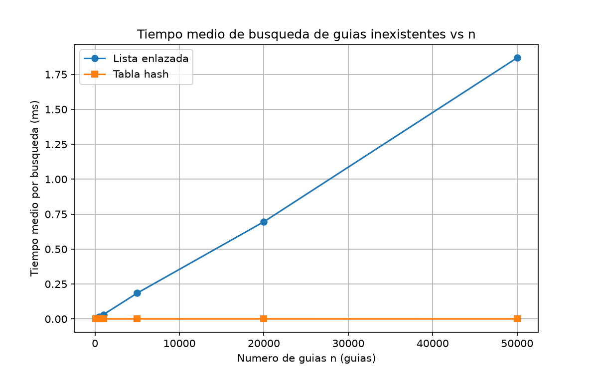
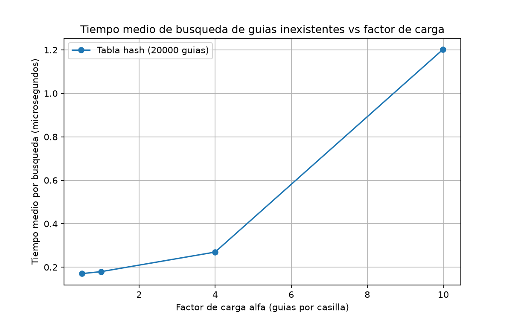

# Lab 3 — Estructuras de datos: de la lista enlazada a la tabla hash

**Nombre:** Juan José Rúa David

**Curso:** Análisis y diseño de algoritmos — Rutas del Caribe

## Instrucciones de reproducción

Desde la raíz del repositorio:

```bash
venv\Scripts\activate          # Windows (Git Bash: source venv/Scripts/activate)
pip install -r requirements.txt
cd lab3-estructuras-datos
python pruebas.py              # corre las pruebas con assert
python medicion.py             # corre los dos experimentos y genera las gráficas
```

Las gráficas quedan en `graficas/`. Las mediciones usan semillas fijas, así que al ejecutarlas de nuevo se usan exactamente las mismas guías.

## Parte 1 — Implementación y verificación

* Código: [estructuras.py](estructuras.py) y [pruebas.py](pruebas.py)

Implementé dos estructuras: una lista simplemente enlazada con inserción al inicio (Θ(1)), y una tabla hash de `m` casillas con el método de la división (`h(k) = k mod m`) y **encadenamiento**, donde cada casilla es una `ListaEnlazada` reutilizada. La búsqueda en la lista es iterativa con `while`, que es obligatorio para no reventar el límite de recursión con miles de nodos. No usé `dict`, `set` ni `hash()` de Python dentro de `estructuras.py`.

La verificación (`pruebas.py`, todas con `assert`) cubre:

1. **Búsqueda exitosa e infructuosa** en la lista y en la tabla (guía presente devuelve su estado; guía ausente devuelve `None`).
2. **Colisión forzada**: con `m = 7`, las guías 10, 24 y 17 caen todas en la casilla 3 (`10 % 7 = 24 % 7 = 17 % 7 = 3`); las tres se insertan y se buscan bien, la lista de la casilla 3 queda con longitud 3 y la búsqueda de una guía inexistente sigue dando `None`.
3. **Factor de carga**: tras esas tres inserciones, `factor_carga()` es exactamente `3/7`.
4. **20 colecciones aleatorias** (semilla fija 42): en cada una, para todas las guías existentes y para guías inexistentes, la lista y la tabla devuelven exactamente lo mismo.

Todas las pruebas pasan al ejecutar `python pruebas.py`.

## Parte 2 — Medición y gráficas

* Código: [medicion.py](medicion.py)

**Cómo medí:** para cada valor de `n` generé guías de diez dígitos distintas con semilla fija 7 y las mismas guías se usan en ambas estructuras. En el Experimento A la tabla usa `m` primo cercano a `n/2` (el factor de carga queda en α ≈ 2). Para cada `n` cronometr** exclu**sivamente **las búsquedas** de **200 guías inexistentes** con `time.perf_counter()`; cronometré cada tanda **3 veces** y reporté el mejor promedio (reduce el ruido de fondo del sistema operativo). La búsqueda infructuosa es la que más le duele al call center porque recorre toda la colección.

**Experimento A — valores medidos** (tiempo medio por búsqueda de guía inexistente):

| n | m (primo) | Lista (ms) | Tabla (ms) |
|---:|---:|---:|---:|
| 100 | 53 | 0.0033 | 0.0002 |
| 500 | 251 | 0.0163 | 0.0002 |
| 1000 | 503 | 0.0312 | 0.0002 |
| 5000 | 2503 | 0.1848 | 0.0003 |
| 20000 | 10007 | 0.6951 | 0.0003 |
| 50000 | 25013 | 1.8685 | 0.0002 |



La curva de la tabla se ve plana frente al eje; es una lectura legítima (la tabla cuesta Θ(1) y la lista Θ(n)). Los valores numéricos están en la tabla de arriba exactamente para poder leerla con precisión.

**Experimento B — valores medidos** (n = 20.000 guías fijas):

| α objetivo | m | α real (n/m) | Tiempo por búsqueda (µs) |
|---:|---:|---:|---:|
| 0.5 | 40009 | 0.50 | 0.20 |
| 1.0 | 20011 | 1.00 | 0.20 |
| 4.0 | 5003 | 4.00 | 0.27 |
| 10.0 | 2003 | 9.98 | 1.20 |



## Parte 3 — Análisis

### 1. Costo teórico

En la lista enlazada, buscar una guía que no existe obliga a recorrerla completa: el ciclo `while` avanza nodo por nodo y solo puede parar al llegar a `None`, y como la cadena tiene `n` nodos, el trabajo es proporcional a `n` cada vez. Por eso ese peor caso (y el caso promedio también, si la guía está a mitad de camino) es Θ(n): no hay salida temprana posible cuando el objetivo no está.

En la tabla con encadenamiento, primero se calcula la casilla `k mod m`, que cuesta lo mismo sin importar `n`, y luego solo se recorre la lista de **esa** casilla, no las otras. Si el hash reparte las claves de forma uniforme, cada lista termina con en promedio `n/m = α` nodos (supuesto clave: **hash uniforme simple** — cada clave cae en cualquier casilla con la misma probabilidad, independiente de las demás). Buscar una guía inexistente recorre los α nodos de su casilla y sale: Θ(1 + α), un trabajo fijo más un número esperado de comparaciones que no depende de `n`, solo de cuán cargada esté la tabla a la que ese `m` da forma. Si todas las guías cayeran en una misma casilla, esa lista dedicada tendría todas las `n` guías y cada búsqueda degeneraría en Θ(n): la tabla hash se comporta exactamente como una lista enlazada con pasos extra en el intermedio; con una mala distribución del hash, la ventaja se difumina ya casi del todo.

### 2. Lo medido contra lo esperado

**Experimento A.** Tomo los valores consecutivos n = 100 → 500: la lista pasa de 3.3 µs a 16.3 µs, es decir, se multiplica ×4.9; con n multiplicado ×5, un costo Θ(n) también multiplica el tiempo ~×5. Coincide. La tabla queda en 0.2 µs promedio en esos dos mismos tamaños: es plana, coherente con Θ(1). Siguiendo la lista más allá del experimento (1000 → 5000: 31.2 µs → 184.8 µs, ×5.9) y 20000 → 50000 (695.1 µs → 1868.5 µs, ×2.7, con ruido al comparar tamaños diez veces mayores), la lista crece linealmente y la tabla no se deja mover por `n`. La primera gráfica lo dice sin teoría: la curva de la lista es una recta inclinada; la de la tabla es una recta pegada al eje.

**Experimento B.** Con n fijo: entre α = 0.5 y 1 el tiempo no cambia (0.2 µs, el trabajo fijo domina); de α = 4 a 10 el tiempo sube de 0.27 µs a 1.2 µs, ×4.4 cuando α subió ×2.5. El salto es el pico de α = 10: con 2003 casillas para 20.000 guías cada lista guarda ~10 nodos en promedio, y cada búsqueda infructuosa hace las ~10 comparaciones de esa lista. El patrón es lineal con α por encima del piso del "1" de Θ(1 + α): crece poco al principio (el "1" fijo domina) y crece rápido en la zona alta (el "α" domina). Coherente con Θ(1 + α).

### 3. Colisiones

Una **colisión** ocurre cuando dos claves diferentes caen en la misma casilla: `h(k1) = h(k2)` con `k1 ≠ k2`. Es inevitable incluso con más casillas que guías, porque el número de guías posibles (10 dígitos = 9 mil millones) es gigantesco frente a `m`, así que por el principio de palomar siempre hay guías distintas que comparten resto. En nuestro ejemplo con `m = 7`: `10 % 7 = 3`, `24 % 7 = 3`, `17 % 7 = 3` — tres guías distintas en la misma casilla 3, cada una apretada en su propia lista a la espera de que la búsqueda las distinga por el valor de la guía.

Formas de resolverlo:

* **Encadenamiento** (el que implementé): cada casilla es una lista enlazada y todos los elementos con el mismo índice conviven ahí. *Ventaja:* simple, la tabla nunca se "llena", insertar siempre es Θ(1) y el rendimiento degrada suavemente si α crece. *Costo:* memoria extra por los nodos y punteros, y si α es grande las búsquedas recorren listas largas.
* **Direccionamiento abierto**: no hay listas; ante la colisión, la clave se reubica en otra casilla de la misma tabla por sondas (lineal, cuadrática, doble hash). *Ventaja:* todo queda en un arreglo, sin punteros, mejor localidad de cache; buscador que trabaja con `α < 1` suele ser más rápido. *Costo:* la tabla puede llenarse y obligar a rehashear (costoso), las colisiones se acumulan entre sí ("clustering") y **borrar** elementos es delicado: hay marcar la casilla con un centinela para no romper las tiras de sondas.

### 4. Tabla hash o árbol de búsqueda

Para el monitoreo por rango, la tabla hash **no sirve**. Su función hash destruye el orden de las guías: `h(k) = k mod m` manda guías cercanas (1000000010 y 1000000011) a casillas distintas si su resto difiere, así que no queda ninguna estructura global que permita saltar a "todas las guías ≥ X y < Y" sin inspeccionar las `m` casillas completas: hay que recorrer las 400.000 guías. Es Θ(n), lo mismo que haría la lista enlazada que se quería jubilar.

Un **árbol de búsqueda binario** es lo que la tabla no puede dar: mantiene las guías ordenadas, así que para "todas las guías entre X y Y" se puede recorrer en orden el fragmento del árbol que cae dentro del rango en Θ(log n + k), donde `k` es la cantidad de resultados (con recorrido en orden, se visitan solo los nodos del rango más los límites). También sirve para el call center: búsqueda puntual en el árbol en Θ(h), típicamente Θ(log n) si el árbol está balanceado.

El peligro: si las 400.000 guías llegaran **ya ordenadas** y se insertaran una a una, cada nueva guía es mayor que todas las anteriores siempre se cuelga del hijo derecho de la última: el árbol degenera en una lista enlazada disfrazada. La altura resultante sería 400.000 (cada nodo a su propio nivel) y una búsqueda tendría, caso pesado, unas 400.000 comparaciones, exactamente lo mismo que recorrer la lista. En un árbol equilibrado la altura es ⌈log₂(400.000)⌉ ≈ 19 y una búsqueda hace ~19 comparaciones: la diferencia es de cuatro órdenes de magnitud (400.000 → 19). Por eso, si el caso real exige rango, el árbol tiene que ser auto-balanceado (AVL, rojo-negro) o no vale nada.

### 5. Concepto para la jefa de operaciones

**Recomendación: tabla hash con encadenamiento para el call center, más un árbol balanceado para el monitoreo por rango.** Dos estructuras, cada una para su consulta; ninguna de las dos hace las dos cosas bien.

* **Consulta puntual → tabla hash.** Con 400.000 guías y `m` primo ~200.000 (α ≈ 2), mi medición da ~0.3 µs por búsqueda infructuosa. Extrapolando a 5.000.000 de envíos con m ~2.500.000 y α ≈ 2: el costo esperado depende de α, no de `n`, y α se mantiene en 2, así que el tiempo por búsqueda es prácticamente el mismo, ~0.3 µs, menos de un millonésimo de segundo. **Esto es una estimación**, no una medición; el razonamiento es que la curva medida contra α es plana a α ≈ 2 (mi experimento B) y plana contra `n` cuando α está acotado (experimento A), así que extender la línea a n = 5M mientras `m` crece con `n` es prolongar regla plana, cosa que la propia gráfica de la parte A respalda hasta 50.000 guías. Contrastemos con la lista enlazada: 1.87 ms con 50.000 guías, relación lineal con `n` (mi gráfica muestra el crecimiento ajustándose a una recta), así que con 100 veces más guías la búsqueda infructuosa tardaría ~100 veces más: **~187 ms ≈ 0,2 s** por consulta. Con decenas de operadores en hora pico, eso son segundos de espera acumulados por minuto; es la consultora a reemplazar.
* **Monitoreo por rango → AVL** (árbol balanceado). Con 5.000.000 de guías, el recorrido del rango cuesta Θ(log₂ n + k) ≈ 23 comparaciones para ubicar el límite izquierdo, más las `k` guías del rango que contienen el lote. Ninguna de las dos estructuras hay que escrita en este lab; el árbol del lab 3 (solo BST sin balancear) quedaría al mismo nivel si el orden de llegada lo degenerara, así que la recomendación práctica incluiría el requisito "árbol con rebalanceo".

**Nota:** la estimación de la lista es directa (lineal medida hasta 50.000, prolongada según esa línea); la de la tabla asume que el hash sigue repartiendo uniforme con 5.000.000 de guías. Si un día el patrón completo de guías se concentrara en pocos valores (o en restos pobres de `m`), el supuesto de hash uniforme simple se rompería y habría que redoñar tamaño o función hash antes de fiarnos del número.
